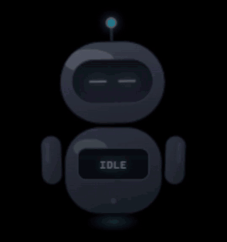
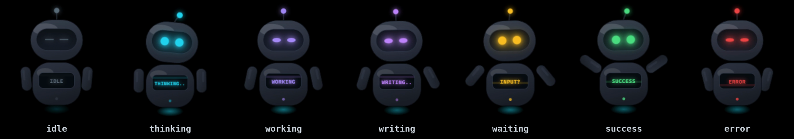
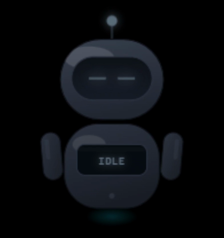
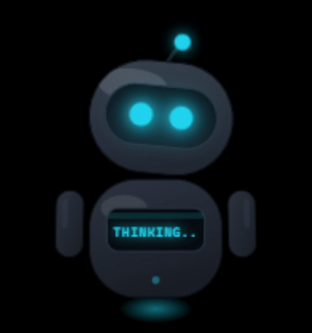
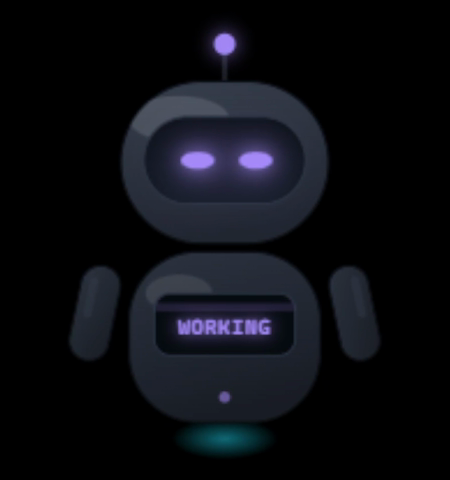
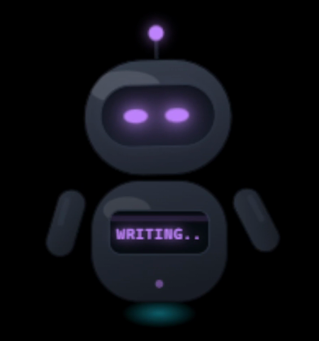
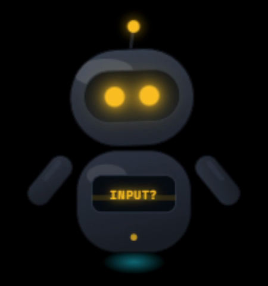
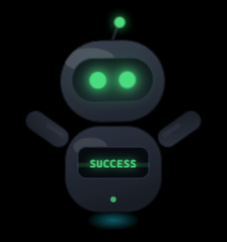
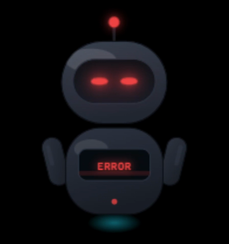

# Claude Robot Widget

<p align="center">
  
</p>

An always-on-top capsule robot that sits in the corner of your desktop and shows
what Claude Code is doing. Electron + SVG, 60 fps, transparent and draggable.

While Claude is thinking, its antenna spins. While it works, the robot goes still
and narrows its eyes. When the job is done, it raises its arms. The screen on its
chest shows what is happening right now.

---

## States



| | State      | Looks like                                                   | Triggered by |
|-|------------|--------------------------------------------------------------|--------------|
|  | `idle`     | Eyes closed, antenna still, slow float                       | 4 s after `Stop`, `SessionStart` |
|  | `thinking` | Antenna spins, head sways, eyes open and blink often         | `UserPromptSubmit`, `PostToolUse` |
|  | `working`  | **Motion stops**, eyes narrow, color turns purple            | `PreToolUse` for read/command tools (tool name on screen) |
|  | `writing`  | Arms move quickly in opposite phase, light purple            | `PreToolUse` for `Write` / `Edit` / `MultiEdit` / `NotebookEdit` (file name on screen) |
|  | `waiting`  | Amber LED, arms open, `INPUT?` on screen                     | `Notification` (Claude is waiting for your input) |
|  | `success`  | Arms up, a little jump, green LED                            | `Stop` |
|  | `error`    | Shake, red LED                                               | Only when set explicitly via MCP |

`error` is intentionally not tied to a hook. A non-zero exit code in `PostToolUse`
doesn't necessarily mean failure (a `grep` with no matches also exits with 1), so
the robot would turn red for no reason. On a real failure, Claude calls
`robot_set_state("error")` itself.

### Why is `working` motionless?

The body stops moving completely to convey focus. A full freeze would make the
widget look like it crashed, though, so four micro-signals stay alive: a slow
horizontal eye scan, an occasional blink every 4.5 seconds, a pulsing antenna LED
and a scan line on the chest screen.

`writing` is the opposite: it stays in the same purple family (both mean "doing
work"), but the arms move quickly. Color tells you the category, motion tells you
the kind of work: reading or producing.

---

## Multiple sessions

Hooks are global, so every open Claude Code session reports to the same widget.
The widget tracks each session **separately** (by `session_id`) and shows the
most important one:

```
waiting  ->  waiting for you, overrides everything
error
writing / working / thinking
success
idle     ->  when all sessions are idle
```

`waiting` is at the top on purpose. The main reason the robot exists is to catch
the moment Claude needs your input; if another busy session could hide that
signal, the widget would be pointless.

The dots under the chest screen show the number of open sessions (up to 5), with
busy ones lit. The screen text alternates every 3 seconds between the file/tool
name and the project name, so you can tell which project is active.

A session is dropped when it sends `SessionEnd` or stays silent for 10 minutes
(for crashed sessions). Right-click → **Sessions** to see the list and click a
session to drop it manually.

---

## Installation

Requirements: Node.js 18+

```bash
git clone https://github.com/oguzozshn/claude-robot-widget.git
cd claude-robot-widget
npm install
npm start
```

The robot appears in the bottom-right corner. Drag it anywhere; its position is
saved.

### Right-click menu

Color theme (neon / silver / blue / red / pastel), size (120–240 px), sound
effects, always on top, click-through on empty areas, state test, reset position,
quit.

---

## Connecting to Claude Code

In the examples below, replace `/path/to/claude-robot-widget` with the absolute
path where you cloned the repository. On Windows, use forward slashes, e.g.
`C:/Users/you/claude-robot-widget`.

### 1. MCP server: let Claude set its own state

```bash
claude mcp add robot -- node "/path/to/claude-robot-widget/mcp-server.js"
```

Claude can then use these tools:

| Tool              | What it does |
|-------------------|--------------|
| `robot_set_state` | Changes the state. Accepts `state`, `text`, `durationMs`, `revertTo` |
| `robot_get_state` | Reads the current state |
| `robot_set_theme` | Changes and saves the color theme |

### 2. Hooks: update the state automatically

Copy the `hooks` block from [`hooks.example.json`](hooks.example.json) into
`.claude/settings.json` (per project) or `~/.claude/settings.json` (global), and
replace `/path/to/claude-robot-widget` with your own path:

```json
{
  "hooks": {
    "SessionStart":     [{ "hooks": [{ "type": "command", "command": "node \"/path/to/claude-robot-widget/hook.js\"", "async": true, "timeout": 5 }] }],
    "UserPromptSubmit": [{ "hooks": [{ "type": "command", "command": "node \"/path/to/claude-robot-widget/hook.js\"", "async": true, "timeout": 5 }] }],
    "PreToolUse":       [{ "matcher": "*", "hooks": [{ "type": "command", "command": "node \"/path/to/claude-robot-widget/hook.js\"", "async": true, "timeout": 5 }] }],
    "PostToolUse":      [{ "matcher": "*", "hooks": [{ "type": "command", "command": "node \"/path/to/claude-robot-widget/hook.js\"", "async": true, "timeout": 5 }] }],
    "Notification":     [{ "hooks": [{ "type": "command", "command": "node \"/path/to/claude-robot-widget/hook.js\"", "async": true, "timeout": 5 }] }],
    "Stop":             [{ "hooks": [{ "type": "command", "command": "node \"/path/to/claude-robot-widget/hook.js\"", "async": true, "timeout": 5 }] }],
    "SessionEnd":       [{ "hooks": [{ "type": "command", "command": "node \"/path/to/claude-robot-widget/hook.js\"", "async": true, "timeout": 5 }] }]
  }
}
```

`async: true` matters: the hook runs in the background and never delays a tool
call. A cosmetic widget shouldn't slow Claude Code down.

The hook also exits quietly when the widget isn't running (800 ms timeout, always
exits with 0), so Claude Code is unaffected when the robot is closed.

To verify the setup, put the robot in `idle` and run any tool: the tool name
(`BASH`, `EDIT`, `READ`...) should appear on the chest screen.

---

## HTTP API

The widget listens on `127.0.0.1:47821` (localhost only). You can drive it from
any script:

```bash
curl -X POST http://127.0.0.1:47821/state \
     -H "Content-Type: application/json" \
     -d '{"state":"working","text":"BUILD"}'

curl http://127.0.0.1:47821/state
```

| Endpoint      | Body |
|---------------|------|
| `POST /state` | `{ state, text?, durationMs?, revertTo? }` |
| `GET /state`  | — |
| `POST /theme` | `{ theme }` |

CLI shortcut:

```bash
node hook.js working BUILD
node hook.js idle
```

If the port is taken, change it with the `CLAUDE_ROBOT_PORT` environment variable
(the widget, the MCP server and the hook all read the same variable).

---

## Customization

Three constants at the top of `renderer.js`:

```js
const SQUINT = 0.50;           // eye openness in working (1 = fully open)
const WORKING_LED = '#a78bfa'; // focus color
const MICRO_BREATH = true;     // 0.7 px breathing motion in working
```

Color themes live in the `.theme-*` classes in `renderer.html`. To add a theme,
add a class there and add its name to the `THEMES` array in `main.js`.

State animations are defined in the `STATES` table in `renderer.js`. Each state
describes a target pose (float amplitude, antenna spin, arm angle, eye openness...)
and the engine lerps the current values toward it every frame. Adding a new state
means adding a row to that table.

Settings (position, theme, size, sound) are stored in `config.json` in Electron's
`userData` folder.

---

## Files

```
main.js            Electron main process: window, context menu, control server
preload.js         contextBridge bridge
renderer.html      Robot SVG and color themes
renderer.js        Animation engine, state machine, dragging, sound
mcp-server.js      MCP stdio server (no dependencies)
hook.js            Claude Code hook bridge + CLI
hooks.example.json Example hook configuration
docs/              Demo GIF and state images used in this README
```

## License

[MIT](LICENSE)
